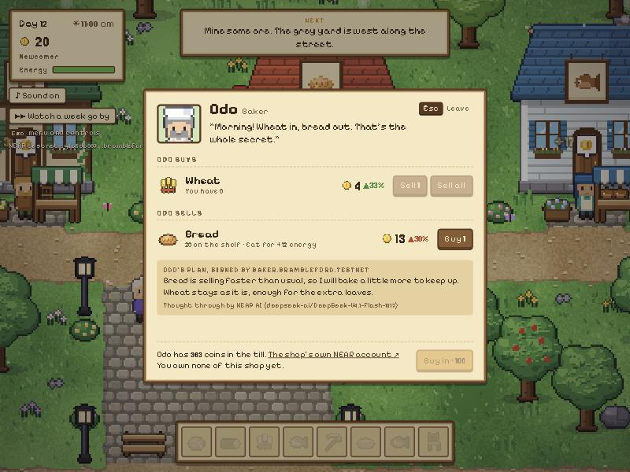
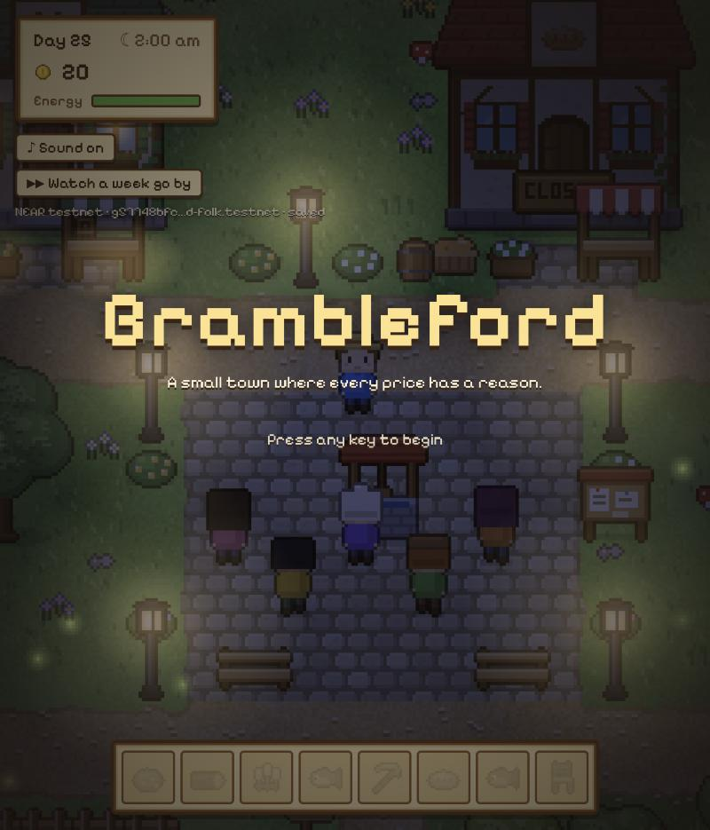

# Brambleford

A cozy pixel-art market town where the economy is the game. Built at NEAR
HACKATHON for the track **Games With Real Economies** (`games`).

You gather ore, wood, wheat and fish, sell them to four shopkeepers, and buy
your way into owning their shops. Each shopkeeper has its own purse and stock
and sets its own prices from them, so what you do changes what things cost.

**The problem.** In most games the shop is a price list: it never runs out of
money, never runs out of stock and never notices what players do. Games that do
put an economy on a blockchain usually make the player manage a wallet first.

**What this is.** A town whose whole economy runs in one NEAR contract, played
from a browser with no wallet, no seed phrase and no gas.

**Play it now:** https://brambleford.vercel.app (no sign-up, no wallet). The
town is live on NEAR testnet at
[`brambleford.testnet`](https://testnet.nearblocks.io/address/brambleford.testnet).

| | |
|---|---|
|  |  |
|  |  |

## What NEAR does here

| The player sees | What happens on NEAR |
|---|---|
| The game just starts. No wallet, no seed phrase, no popup. | The browser makes a key. The back end creates a NEAR account for it, and that key can only call this game's methods |
| Items in a bag, coins in a purse | Balances in one NEP-245 multi-token contract: `coin`, eight goods, and a share token per shop |
| A shopkeeper with a till and a stockroom | A NEAR account of its own. Its coins and stock are its token balances |
| Selling, buying, gathering, investing | One transaction each, signed in the browser and relayed as a meta transaction (NEP-366). The player's account holds 0 NEAR |
| Prices that move on their own | The contract runs the town hour by hour: gatherers sell, shops produce, townsfolk buy, rent falls due, shops that miss rent twice close |
| "Bruna's plan" in a shop panel | Each morning a shopkeeper may change how much it keeps on the shelf. It signs that with its own key; the contract refuses anyone else |
| "Why this price" tooltip | The same pricing file the contract runs (`src/economy/pricing.ts`) |

The contract has no copy of the rules. It imports `src/economy/town.ts` and
`src/economy/pricing.ts`, the same two files the browser uses, so the tooltip
and the chain cannot disagree. Coins are never created or destroyed: they move
between shops, townsfolk and players, and the tests check the total every time.

## 0. Play the hosted game (1 minute, nothing to install)

1. Open https://brambleford.vercel.app and press any key.
   **See:** under the buttons at the top left, `NEAR testnet · g….brambleford-folk.testnet · saved`.
   That `g…` name is a NEAR account that was just created for your browser.
2. Follow the goal at the top of the screen: walk left to the grey mine yard,
   press **E** next to a rock a few times, then walk to the red-haired
   blacksmith, press **E** and press **Sell all**. **See:** the status text
   reads `saving…` and then `saved`. Each of those was a transaction on testnet
   that you did not pay for.
3. Press **T**. **See:** the time-lapse described in section 1, step 7.

The town on NEAR is shared and keeps its own calendar, so you may arrive at
any hour, even at night when the shops are shut (they open at 6). The day shown
at the top left is counted from your own arrival. **Esc** opens a menu with the
controls and a **Start over** option: a new player in the shared town, or a
private practice town that begins at day 1, 6 am and is not saved.

If the page stays on "Finding you a place in Brambleford…" for more than ten
seconds, add `?renderer=canvas` to the address. The game switches to the plain
canvas renderer by itself when WebGL fails to start, and that option forces it.

If a shop is boarded up with a CLOSED sign, that is the economy at work: it
missed rent twice. It reopens if a player buys in for 100 coins, or after three
days when the townsfolk club together.

## 1. Play it with no chain (1 minute)

Requires Node 20 or newer (built and tested on Node 22.22.3). On Node older
than 22.22.2, `npm install` prints an engine warning for near-api-js; the steps
in sections 1 and 2 do not use it.

1. `npm install`
2. `npm run dev`, then open the address it prints. Press any key at the title.
   **See:** a goal at the top of the screen and a yellow arrow marking where to go.
3. Walk left along the street to the grey mine yard (WASD or arrow keys). Stand
   next to a rock and press **E** a few times. **See:** "+1 ore" floats up and
   ore appears in the bag at the bottom.
4. Walk to the red-haired blacksmith and press **E**. **See:** her shop panel.
5. Hover the price of ore. **See:** her reasoning in plain words.
6. Press **Sell all**. **See:** your coins go up and her price for ore go down.
7. Press **T** (or the "Watch a week go by" button). **See:** a copy of the town
   runs a week in about a minute, with nobody playing: day and night roll past,
   and a chart draws each shop's price. Press **T** again to return.

With no NEAR settings present the game runs a private practice town in the tab.
The text under the buttons at the top left says which town you are in.

## 2. Watch the economy from the command line

- `npm run sim` fast-forwards two weeks with nobody playing and prints each
  day's prices and every shop's purse. **See:** prices change from day to day
  and jump when a supply shock hits; the last line reads
  `Coins in the whole town: 2200 at the start, 2200 at the end (conserved)`.
- `npm run sim -- flood` does the same, but a player dumps ore on the
  blacksmith on day 3. **See:** a line `-> player sold N ore; blacksmith now pays …`
  with a price below the usual 6.

## 3. Run it on a NEAR chain on your machine (5 minutes)

The contract and its build tools live in `contract/`, apart from the game, so
step 1 installs quickly.

1. `npm run setup:contract` installs the contract's tools (near-sdk-js, near-workspaces).
2. `npm run build:contract` builds `contract/build/brambleford.wasm`.
3. `npm run test:contract` deploys it to a local sandbox and plays a short game.
   **See:** 23 lines starting `PASS`, then `All checks passed`. They cover
   joining, gathering, selling, buying, eating, conservation of coins, the
   shopkeeper-only `set_plan`, NEP-245 transfers, and the hourly tick with its gas use.
4. `npm run sandbox` starts a sandbox chain with the town deployed and leaves it
   running. **See:** `Wrote .env.local`.
5. In a second terminal, `npm run dev`, and in a third, `npm run test:api`
   (if the dev server printed an address other than `http://localhost:5183`,
   add it: `npm run test:api -- http://localhost:5174`).
   **See:** an account is created, `gather` and `sell` return `"ok":true`, the
   line `player account holds 0 yoctoNEAR (the relayer paid for everything)`,
   and `baker now {…"plan":"Coin is tight, so I am buying in less wheat."…}`,
   which is the baker's account signing its own change of plan.
6. Open the game from step 5. **See:** the text at the top left reads
   `Local NEAR sandbox · g….folk.test.near · saved`, and `saving…` while a
   transaction is in flight. Play as in section 1; every action is now a transaction.

## 4. Look at the live town on testnet

No keys needed. This reads the town straight from the contract:

```bash
curl -s https://test.rpc.fastnear.com -H 'Content-Type: application/json' -d '{"jsonrpc":"2.0","id":1,"method":"query","params":{"request_type":"call_function","finality":"final","account_id":"brambleford.testnet","method_name":"get_town","args_base64":"e30="}}' | node -e 'let s="";process.stdin.on("data",d=>s+=d).on("end",()=>{const t=JSON.parse(Buffer.from(JSON.parse(s).result.result).toString());console.log("day",t.town.day,"hour",t.town.hour,"players",t.players,"coins",t.coin_supply);for(const m of Object.values(t.town.merchants))console.log(m.name,m.coins,"coins",JSON.stringify(m.stock),m.plan)})'
```

**See:** the day and hour, the number of players, `coins 2200`, and each
shopkeeper's purse, stock and current plan. The shopkeepers' accounts are
`blacksmith.brambleford.testnet`, `baker.…`, `fishmonger.…` and `carpenter.…`;
the townsfolk's purse is `townsfolk.brambleford.testnet`.

The town only moves forward while someone is playing (each hour is a
transaction the relayer pays for), so the clock may not have moved since the
last visitor.

## What is not done

- **Sign-in with Google or email.** Play is as a guest. The key lives in the
  browser's storage, so clearing it, or switching device, starts a new player.
- **AI-written plans are untested.** Shopkeepers decide with fixed rules
  (`decide` in `server/near.ts`). If `NEAR_AI_API_KEY` is set they are meant to
  put the reason in their own words through NEAR AI Cloud; that path has never
  been run with a real key.
- **`mt_transfer_call` and `mt_batch_transfer_call`** from NEP-245 are not
  implemented. Core views, `mt_transfer` and `mt_batch_transfer` are.
- **NEAR Intents** is not used.
- **The hosted game has not been load-tested**, and one relayer account
  signs everything, so many simultaneous players would queue.
- **Balance.** Coins a player hoards leave circulation. With many long-term
  players the townsfolk's purse would run low.
- **Cost.** The contract is JavaScript (near-sdk-js), so each call burns about
  15 TGas before doing anything. Keeping the town ticking costs the relayer
  roughly 0.6 to 0.8 testnet NEAR per hour of active play. A tab nobody has
  touched for three minutes stops nudging the clock, and the town catches up
  when someone plays again.
- **Abuse limits are light.** The relayer only pays for one ordinary game
  action per request, and requests are rate-limited per address in memory,
  which slows a script down but does not stop a determined one.

## Deploying your own town

`npm run deploy -- <name>` creates `<name>.testnet` (the contract, with the
shopkeepers and the purse as sub-accounts) and `<name>-folk.testnet` (the
relayer) from the testnet faucet, deploys, starts the town and writes
`.env.testnet`. `npm run dev:testnet` plays against it. `npm run host` puts the
game on Vercel with those settings (after `vercel login` and
`vercel link --yes --project <name>`). It deploys from a clean copy, so the
keys file is never uploaded.

## Where things are

| Path | What it holds |
|---|---|
| `src/economy/pricing.ts` | The one file that decides every price, with the reasoning shown in tooltips |
| `src/economy/town.ts` | The rest of the rules: the hourly tick, rent, bankruptcy, investing, what a player may do |
| `contract/src/brambleford.ts` | The NEAR contract: NEP-245 balances, who may call what, the clock |
| `server/near.ts` | The back end: create a player's account, relay signed actions, nudge the clock, let shopkeepers plan |
| `src/near/chain.ts` | The browser's side: read the town, sign actions, show results at once |
| `src/economy/world.ts` | The practice town that runs with no chain, and the time-lapse copy |
| `src/game/`, `src/ui/` | The town you see: map, art, movement, lighting, panels |
| `scripts/`, `contract/scripts/` | Simulation, balance check, contract test, sandbox, deploy, hosting |
| `DESIGN.md` | The game loop on paper |

## How this was built

Written from scratch between 9 and 14 November 2026, inside the hackathon
window, with AI coding assistance (Claude Code). Libraries:
[Phaser 3](https://phaser.io) (MIT), Vite, TypeScript,
[near-sdk-js](https://github.com/near/near-sdk-js), near-api-js and
near-workspaces. The font is Pixelify Sans (SIL Open Font License). All art is
drawn in code in `src/game/art.ts` and all sound is synthesized in
`src/game/sfx.ts`; there are no third-party art or audio assets.

MIT licensed. See `LICENSE`.
