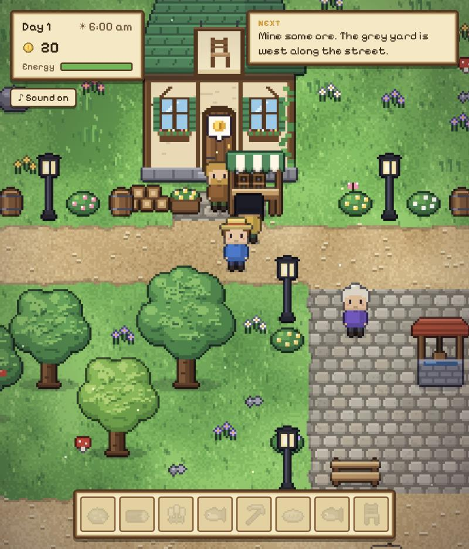
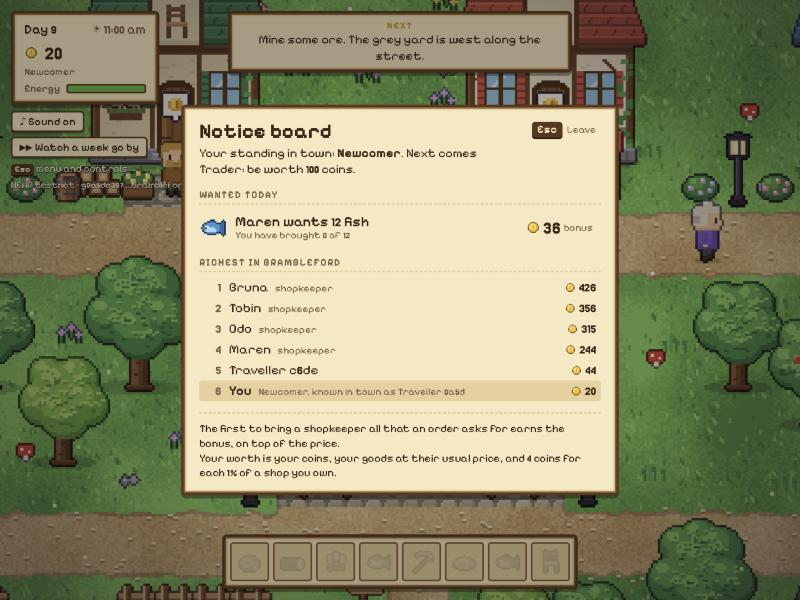
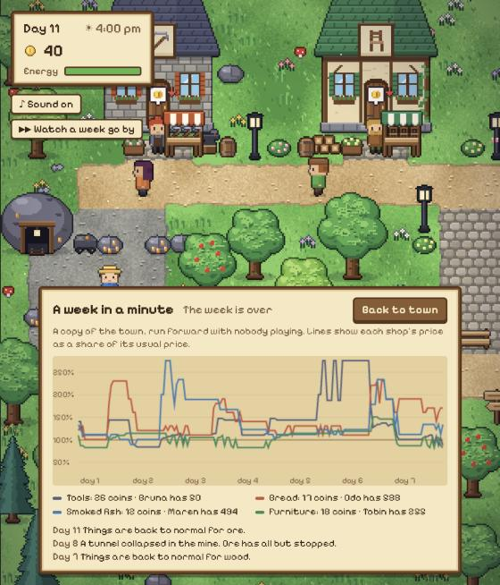

# Brambleford

[](https://github.com/hussam2444/brambleford/actions/workflows/ci.yml)

A cozy pixel-art market town where the economy is the game. Built at NEAR
HACKATHON for the track **Games With Real Economies** (`games`).

You gather ore, wood, wheat and fish, sell them to four shopkeepers, fill the
orders they pin to the notice board, and buy your way into owning their shops.
Each shopkeeper has its own purse and stock, sets its own prices from them, and
decides for itself how much to keep on the shelf, so what you do changes what
things cost.

**The problem.** In most games the shop is a price list: it never runs out of
money, never runs out of stock and never notices what players do. Games that do
put an economy on a blockchain usually make the player manage a wallet first.

**What this is.** A town whose whole economy runs in one NEAR contract, played
from a browser with no wallet, no seed phrase and no gas. Each shopkeeper is a
NEAR account of its own: a model on NEAR AI Cloud works out its plan for the
day inside hard limits, and the shopkeeper signs that plan with its own key.
The town keeps its hours whether or not anyone is playing.

**Play it now:** https://brambleford.vercel.app (no sign-up, no wallet). The
town is live on NEAR testnet at
[`brambleford.testnet`](https://testnet.nearblocks.io/address/brambleford.testnet).

| | |
|---|---|
|  |  |
|  |  |

## What NEAR does here

| The player sees | What happens on NEAR |
|---|---|
| The game just starts. No wallet, no seed phrase, no popup. | The browser makes a key. The back end creates a NEAR account for it, and that key can only call this game's methods |
| Items in a bag, coins in a purse | Balances in one NEP-245 multi-token contract: `coin`, eight goods, and a share token per shop |
| A shopkeeper with a till and a stockroom | A NEAR account of its own. Its coins and stock are its token balances |
| Selling, buying, gathering, investing | One transaction each, signed in the browser and relayed as a meta transaction (NEP-366). The player's account holds 0 NEAR |
| Prices that move on their own | The contract runs the town hour by hour: gatherers sell, shops produce, townsfolk buy, rent falls due, shops that miss rent twice close |
| "Bruna's plan" in a shop panel, and who thought it through | Once a day a shopkeeper may change how much it keeps on the shelf. A model on NEAR AI Cloud decides, inside hard limits. The shopkeeper signs with its own key; the contract refuses anyone else, checks the limits again, and stores the plan with the name of whoever decided |
| A wanted order on the notice board, and a bonus for filling it | The order is part of the town's state in the contract. The bonus moves from the shopkeeper's balance to the player's in the same transaction as the sale, with its own `mt_transfer` event |
| Your standing, and the richest players in town | Worked out by the contract from balances and shop shares, and kept as a top-ten list in its state |
| The town carries on while you are away | A timer calls the contract's `tick` every ten minutes and moves an empty town three game hours each time |
| Sign in with Google (optional) | One NEAR account per Google identity. Each browser you sign in on gets its own key on that account, limited to this game's methods |
| Coins that do not vanish with players who wander off | The town has 2,200 coins and no more. A player who has done nothing for three hours has left town: the contract moves their coins back to the townsfolk, with an `mt_transfer` event. Their goods and shop shares stay theirs, and they are given a newcomer's 20 coins when they come back |
| "Why this price" tooltip | The same pricing file the contract runs (`src/economy/pricing.ts`) |

The contract has no copy of the rules. It imports `src/economy/town.ts` and
`src/economy/pricing.ts`, the same two files the browser uses, so the tooltip
and the chain cannot disagree. Coins are never created or destroyed: they move
between shops, townsfolk and players, and the tests check the total every time.

## Check the claims

Each row is something this README says, where to see it, and a real
transaction on testnet. Explorer pages open in any browser; nothing to install.

| Claim | See it for yourself | A real transaction |
|---|---|---|
| The contract runs the town's hours, not a server | Section 4 prints the town straight from the contract. The clock is the contract's `tick` method, which anyone may call | [`tick`](https://testnet.nearblocks.io/txns/EUEkoZG524YSMsvc3cRoa23sFeAwsDYAGe9wv72VSp4Z): its log has a `hours_passed` event with each shop's takings |
| Each shopkeeper is its own account and signs its own plan | In the game, a shop panel shows "…'s plan, signed by baker.brambleford.testnet" and links to that account | [`set_plan` signed by `baker.brambleford.testnet`](https://testnet.nearblocks.io/txns/HLbZ3HcaUJuYUs8XB1ywrfKUskqJTh1ynyRC4y4g5DyM). The contract refuses `set_plan` from anyone else (covered by `npm run test:contract`) |
| A language model decides that plan, and the chain records which one | In the game, under a shop's plan: "Thought through by NEAR AI (deepseek-ai/DeepSeek-V4.1-Flash-1017)". Section 4 prints the same from the contract | [`set_plan` by the baker](https://testnet.nearblocks.io/txns/4K3aGFPmDAmbvKYy6uEGCp8RmW9JXWL5QcnUtUHRxv2p): its arguments are the new shelf targets, the reason in the baker's words, and `thinker` |
| A wanted order pays a bonus out of the shopkeeper's own purse | `npm run play:order -- https://brambleford.vercel.app` sends a guest with no screen to fill today's order and prints the transaction | [`sell` that filled Maren's order for 10 fish](https://testnet.nearblocks.io/txns/FvqQ1yN1sxwXGJXqnzqUTKZQRugHzyY97MPs8wKTtQen): the log has a second `mt_transfer` of 30 coins with the memo `bonus for filling an order` |
| The town keeps its hours with nobody playing | Run the command in section 4 twice, fifteen minutes apart, with the game closed. **See:** the hour has moved on | [`tick` sent by the host's timer](https://testnet.nearblocks.io/txns/33K95qYEspc2spYBLxRxf5FNX3ZqZ5RrE2FoN6eQ6wpH) at 18:50:05 UTC on 14 November, ten minutes after the last player's move |
| A guest signs each action in the browser, the relayer pays, and the guest holds 0 NEAR | In the game: **Esc**, then the explorer link at the bottom of the menu, lists your own `join`, `gather` and `sell` | [`sell` by a guest](https://testnet.nearblocks.io/txns/HPTRzSKwkEjQenNfoiyFh9UgMykJkjGkRFY8PFxswXdw): signed by `brambleford-folk.testnet`, carrying a delegate action from [the guest's account](https://testnet.nearblocks.io/address/g4e65cfbec48010d4.brambleford-folk.testnet) |
| Coins, goods and shop shares are NEP-245 balances in one contract | Run the command below. **See:** five numbers in quotes: the blacksmith's coins, ore, wood, tools, and the shares of her shop held by her own account (`"0"`) | [The contract's account](https://testnet.nearblocks.io/address/brambleford.testnet) |
| Shops go under and come back with no one patching anything | Section 4 prints the town's recent history | The history lines in section 4 are stored by the contract itself |
| Coins are never created or destroyed | Section 4 prints `coins 2200`. `npm run test:rules` plays 300 random games and counts the coins after every step; `npm run sim` and `npm run test:contract` count them too | |

```bash
curl -s https://test.rpc.fastnear.com -H 'Content-Type: application/json' -d '{"jsonrpc":"2.0","id":1,"method":"query","params":{"request_type":"call_function","finality":"final","account_id":"brambleford.testnet","method_name":"mt_batch_balance_of","args_base64":"eyJhY2NvdW50X2lkIjoiYmxhY2tzbWl0aC5icmFtYmxlZm9yZC50ZXN0bmV0IiwidG9rZW5faWRzIjpbImNvaW4iLCJvcmUiLCJ3b29kIiwidG9vbHMiLCJzaGFyZTpibGFja3NtaXRoIl19"}}' | node -e 'let s="";process.stdin.on("data",d=>s+=d).on("end",()=>console.log(Buffer.from(JSON.parse(s).result.result).toString()))'
```

What this entry is not: the model only chooses how much a shop keeps on the
shelf (it cannot set a price or move a coin), the game loop is small, and
signing in with Google leaves a second key with the game's relayer. The full
list is under "What is not done".

## How a shopkeeper thinks

Once a game day, while the shops are open, each shopkeeper looks over its own
books and may change how many of each good it likes to keep on the shelf.
Those targets drive the rest: what it pays gatherers, how much it makes, what
it charges.

1. **The model sees one shop's books and nothing else.** Coins, rent, stock,
   targets, recent sales and the day's supply news, written as numbers and
   fixed words. Nothing a player typed reaches the prompt (no account names,
   no chat), so nobody can talk to the model through the town.
2. **It answers as the shopkeeper**, with new targets and a short reason.
   The first model asked is `deepseek-ai/DeepSeek-V4.1-Flash-1017`, which
   NEAR AI serves privately from its own attested hardware (a TEE). If it gives
   nothing usable within 8 seconds, `anthropic/claude-haiku-5-5` is asked
   through the same NEAR AI Cloud key. If that fails too, the fixed rules in
   `decide()` make the plan.
3. **The answer is never trusted.** Only goods the shop already stocks get
   through, as whole numbers from 1 to 40, at most 3 away from today's target.
   The reason is cut down to one plain line.
4. **The shopkeeper signs it.** Its own NEAR account calls `set_plan` with its
   own key. The contract refuses that call from anyone else, checks the range
   again, and stores the plan, the reason and who decided.

So a model can make a shopkeeper bold or careful, and it can be wrong, but it
cannot make a coin, set a price directly or touch another shop. The code is in
`server/near.ts`; `npm run test:server` checks it against hostile replies.

## 0. Play the hosted game (1 minute, nothing to install)

1. Open https://brambleford.vercel.app and press any key.
   **See:** under the buttons at the top left, `NEAR testnet · g….brambleford-folk.testnet · saved`.
   That `g…` name is a NEAR account that was just created for your browser.
2. Follow the goal at the top of the screen: walk left to the grey mine yard,
   press **E** next to a rock a few times, then walk to the red-haired
   blacksmith, press **E** and press **Sell all**. **See:** the status text
   reads `saving…` and then `saved`. Each of those was a transaction on testnet
   that you did not pay for.
3. With her shop panel open, read the box under the prices. **See:** "Bruna's
   plan, signed by blacksmith.brambleford.testnet", her reason in her own
   words, and "Thought through by NEAR AI (…)": the model that decided it.
4. Press **Esc** to leave the shop, walk to the notice board in the square
   (just right of the well) and press **E**. **See:** what the shopkeepers want
   today and the bonus each will pay, your standing, and the richest players in
   town. Bring a shopkeeper everything an order asks for and the bonus is
   yours, out of that shopkeeper's purse.
5. Press **T**. **See:** the time-lapse described in section 1, step 7.

To keep one player on every device, press **Esc** and choose **Sign in with
Google**. It is optional: without it you play as a guest whose key lives in
this browser.

Coin does not sit idle in Brambleford. If you do nothing for more than three
hours, the town takes you to have left and your coins go back to the
townsfolk. Your goods and your shares in shops are kept, and you are given 20
coins again when you return. Buying into a shop is how you keep what you earn.

The town on NEAR is shared and keeps its own calendar, so you may arrive at
any hour, even at night when the shops are shut (they open at 6). The day shown
at the top left is counted from your own arrival. **Esc** opens a menu with the
controls and a **Start over** option: a new player in the shared town, or a
private practice town that begins at day 1, 6 am and is not saved.

If the page stays on "Finding you a place in Brambleford…" for more than ten
seconds, add `?renderer=canvas` to the address. The game switches to the plain
canvas renderer by itself when WebGL fails to start, and that option forces it.

If a shop is boarded up with a CLOSED sign, that is the economy at work: it
missed rent twice. It reopens if a player buys in for 100 coins, or after three
days when the townsfolk club together.

## 1. Play it with no chain (1 minute)

Requires Node 20 or newer (built and tested on Node 22.22.3). On Node older
than 22.22.2, `npm install` prints an engine warning for near-api-js; the steps
in sections 1 and 2 do not use it.

1. `npm install`
2. `npm run dev`, then open the address it prints. Press any key at the title.
   **See:** a goal at the top of the screen and a yellow arrow marking where to go.
3. Walk left along the street to the grey mine yard (WASD or arrow keys). Stand
   next to a rock and press **E** a few times. **See:** "+1 ore" floats up and
   ore appears in the bag at the bottom.
4. Walk to the red-haired blacksmith and press **E**. **See:** her shop panel.
5. Hover the price of ore. **See:** her reasoning in plain words.
6. Press **Sell all**. **See:** your coins go up and her price for ore go down.
7. Press **T** (or the "Watch a week go by" button). **See:** a copy of the town
   runs a week in about a minute, with nobody playing: day and night roll past,
   and a chart draws each shop's price. Press **T** again to return.

With no NEAR settings present the game runs a private practice town in the tab.
The text under the buttons at the top left says which town you are in.

## 2. Watch the economy from the command line

- `npm run sim` fast-forwards two weeks with nobody playing and prints each
  day's prices and every shop's purse. **See:** prices change from day to day
  and jump when a supply shock hits; the last line reads
  `Coins in the whole town: 2200 at the start, 2200 at the end (conserved)`.
- `npm run sim -- flood` does the same, but a player dumps ore on the
  blacksmith on day 3. **See:** a line `-> player sold N ore; blacksmith now pays …`
  with a price below the usual 6.
- `npm run test:rules` checks the rules themselves, with no chain: prices,
  rent, dividends, orders, hostile input, and 300 random games in which every
  accepted move is checked to the coin. **See:** `All 293 checks passed, 1
  known problem(s) listed above`. The known problem is printed in full, and is
  the one under "Balance" below.

## 3. Run it on a NEAR chain on your machine (10 minutes)

The contract and its build tools live in `contract/`, apart from the game, so
step 1 installs quickly.

1. `npm run setup:contract` installs the contract's tools (near-sdk-js, near-workspaces).
2. `npm run build:contract` builds `contract/build/brambleford.wasm`.
3. `npm run test:contract` deploys it to a local sandbox and plays a short game.
   It takes about five minutes, because it moves the sandbox's clock on by
   hours to see what happens to players who leave.
   **See:** 52 lines starting `PASS`, then `All checks passed`. They cover
   joining, gathering, selling, buying, eating, conservation of coins, the
   shopkeeper-only `set_plan`, wanted orders and their bonus, the richest list,
   a part-owner who goes away and comes back, a player who leaves town and
   returns, NEP-245 transfers, and the hourly tick with its gas use.
4. `npm run sandbox` starts a sandbox chain with the town deployed and leaves it
   running. **See:** `Wrote .env.local`.
5. In a second terminal, `npm run dev`, and in a third, `npm run test:api`
   (if the dev server printed an address other than `http://localhost:5183`,
   add it: `npm run test:api -- http://localhost:5174`).
   **See:** an account is created, `gather` and `sell` return `"ok":true`, the
   line `player account holds 0 yoctoNEAR (the relayer paid for everything)`,
   and `baker now {…"plan":"Coin is tight, so I am buying in less wheat."…}`,
   which is the baker's account signing its own change of plan.
6. Open the game from step 5. **See:** the text at the top left reads
   `Local NEAR sandbox · g….folk.test.near · saved`, and `saving…` while a
   transaction is in flight. Play as in section 1; every action is now a transaction.

## 4. Look at the live town on testnet

No keys needed. This reads the town straight from the contract:

```bash
curl -s https://test.rpc.fastnear.com -H 'Content-Type: application/json' -d '{"jsonrpc":"2.0","id":1,"method":"query","params":{"request_type":"call_function","finality":"final","account_id":"brambleford.testnet","method_name":"get_town","args_base64":"e30="}}' | node -e 'let s="";process.stdin.on("data",d=>s+=d).on("end",()=>{const t=JSON.parse(Buffer.from(JSON.parse(s).result.result).toString());console.log("day",t.town.day,"hour",t.town.hour,"players",t.players,"coins",t.coin_supply);for(const m of Object.values(t.town.merchants))console.log(m.name,m.open?"open":"SHUT",m.coins,"coins",JSON.stringify(m.stock),m.plan,m.thinker?"["+m.thinker+"]":"");for(const o of t.town.orders||[])console.log("wanted on day",o.day+":",o.wanted,o.good,"for the",o.merchant+",","bonus",o.bonus,o.wonBy?"(filled)":"(open)");console.log("richest",JSON.stringify(t.richest));for(const e of t.town.events)console.log("day",e.day,e.text)})'
```

**See:** the day and hour, the number of players, `coins 2200`, each
shopkeeper's purse, stock and current plan with who thought it through in
square brackets, the orders on the notice board, the richest players, and then
the town's recent history, one line per event. At the time of writing that history included
`day 37 Maren the fishmonger has shut up shop. Rent went unpaid 2 days running.`
and `day 40 The townsfolk clubbed together and Maren the fishmonger is open again.`
Nobody wrote those: a run of bad fishing did it. The shopkeepers' accounts are
`blacksmith.brambleford.testnet`, `baker.…`, `fishmonger.…` and `carpenter.…`;
the townsfolk's purse is `townsfolk.brambleford.testnet`.

The town keeps its hours with nobody playing. The host's timer calls `tick`
every ten minutes and asks for three game hours each time, so an empty town
ambles through about one game day every hour and twenty minutes. While someone
plays, their tab nudges the clock every game hour instead, and a day takes two
and a half minutes.

## Tests

| Command | What it checks | Needs |
|---|---|---|
| `npm test` | The types, a two-week run of the economy, the shared rules (`test:rules`, 293 checks), the back end with the model and the chain stood in (`test:server`, 211 checks), and the Google sign-in checks (`test:google`, 25 checks) | Nothing but `npm install` |
| `npm run test:contract` | 52 checks against the real contract on a local sandbox chain (it fast-forwards the chain by hours, so allow five minutes) | `npm run setup:contract`, `npm run build:contract` |
| `OLD_WASM=<an older build> npm run test:contract` | The same, plus an upgrade rehearsal: a town started by the older contract, then the new code deployed over it | An older `brambleford.wasm` |
| `npm run test:api` | The HTTP API end to end: a guest joins, signs, is relayed; a shopkeeper plans; two browsers share one signed-in player | `npm run sandbox` and `npm run dev` running |
| `npm run play:order -- <address>` | One guest with no screen fills a wanted order through the public API | The hosted game, or a sandbox and dev server |

Every push runs `npm test` and the contract tests on GitHub (`.github/workflows/ci.yml`).

## What is not done

- **Signing in with Google leaves a key with the relayer.** A signed-in
  player's account carries a second, full-access key held by the game's
  relayer. That key is what adds your next device without a wallet, and it
  means whoever runs the relayer could act for signed-in players. Guest
  accounts carry no such key. A guest's progress is not carried over on first
  sign-in, one player can use three browsers at a time, and there is no email
  sign-in. The whole path is tested on a local chain with a stand-in for
  Google, and the hosted game shows Google's button and turns away a made-up
  credential, but nobody had yet signed in on the hosted game with a real
  Google account when this was written.
- **The model's reach is small on purpose.** It picks shelf targets once a
  day. It does not set prices, talk to players or bargain.
- **"Already asked today" is kept in the server's memory.** After the host
  restarts, a shopkeeper who chose to change nothing may be asked once more.
- **The richest list is as of each player's last action.** It is a list the
  contract keeps up to date as players act, not a fresh count of everyone.
- **A bonus can be shown a moment early.** The page applies your sale at once
  with the shared rules. If another player filled the same order in that
  moment, the chain pays no bonus and the page corrects itself on the next read.
- **`mt_transfer_call` and `mt_batch_transfer_call`** from NEP-245 are not
  implemented. Core views, `mt_transfer` and `mt_batch_transfer` are.
- **NEAR Intents** is not used.
- **The hosted game has not been load-tested**, and one relayer account
  signs everything, so many simultaneous players would queue.
- **Balance.** The town's 2,200 coins have to go round, so it cannot afford
  to lose them to people who leave. Two rules see to that. A player who has
  done nothing for three real hours has left town, and their coins go back to
  the townsfolk (goods and shares are kept, and a return is greeted with 20
  coins). A part-owner who has done nothing for more than three game days is
  paid no dividend until they are back. What these do not cover: a player who
  stays, only earns and never spends can still gather most of the town's coins.
  Shops then shut until that player buys into them, which is the game working
  as meant, but nothing forces it.
- **Cost.** The contract is JavaScript (near-sdk-js), so each call burns about
  15 TGas before doing anything. Keeping the town ticking costs the relayer
  roughly 0.6 to 0.8 testnet NEAR per hour of active play, and the timer about
  half a NEAR a day with nobody there. A tab nobody has touched for three minutes stops
  nudging the clock.
- **Abuse limits are light.** The relayer only pays for one ordinary game
  action per request, and requests are rate-limited per address in memory,
  which slows a script down but does not stop a determined one.

## Deploying your own town

`npm run deploy -- <name>` creates `<name>.testnet` (the contract, with the
shopkeepers and the purse as sub-accounts) and `<name>-folk.testnet` (the
relayer) from the testnet faucet, deploys, starts the town and writes
`.env.testnet`. `npm run dev:testnet` plays against it. `npm run host` puts the
game on Vercel with those settings (after `vercel login` and
`vercel link --yes --project <name>`). It deploys from a clean copy, so the
keys file is never uploaded.

Two optional settings go in the same file, and `.env.example` explains both:
`NEAR_AI_API_KEY` lets a model decide the shopkeepers' plans (without it the
fixed rules do), and a Google client id turns on signing in with Google
(without it everyone is a guest). The timer in `vercel.json` needs a Vercel
plan that allows a job every ten minutes.

## Where things are

| Path | What it holds |
|---|---|
| `src/economy/pricing.ts` | The one file that decides every price, with the reasoning shown in tooltips |
| `src/economy/town.ts` | The rest of the rules: the hourly tick, rent, bankruptcy, investing, what a player may do |
| `contract/src/brambleford.ts` | The NEAR contract: NEP-245 balances, who may call what, the clock |
| `server/near.ts` | The back end: create a player's account, relay signed actions, nudge the clock, ask a model for each shopkeeper's plan and have the shopkeeper sign it |
| `server/google.ts`, `src/near/google.ts` | Signing in with Google: checking the credential on the back end, the button in the browser |
| `src/near/chain.ts` | The browser's side: read the town, sign actions, show results at once |
| `src/economy/world.ts` | The practice town that runs with no chain, and the time-lapse copy |
| `src/game/`, `src/ui/` | The town you see: map, art, movement, lighting, panels |
| `scripts/`, `contract/scripts/` | Simulation, balance check, the tests, a guest with no screen, sandbox, deploy, hosting |
| `vercel.json` | The hosted function's settings and the timer that keeps the town's hours |
| `DESIGN.md` | The game loop on paper |

## How this was built

Written from scratch between 9 and 14 November 2026, inside the hackathon
window, with AI coding assistance (Claude Code). Libraries:
[Phaser 3](https://phaser.io) (MIT), Vite, TypeScript,
[near-sdk-js](https://github.com/near/near-sdk-js), near-api-js and
near-workspaces. The shopkeepers' plans come from models served by
[NEAR AI Cloud](https://cloud.near.ai). The fonts are Pixelify Sans and
Jersey 15 (SIL Open Font License). All art is
drawn in code in `src/game/art.ts` and all sound is synthesized in
`src/game/sfx.ts`; there are no third-party art or audio assets.

MIT licensed. See `LICENSE`.
